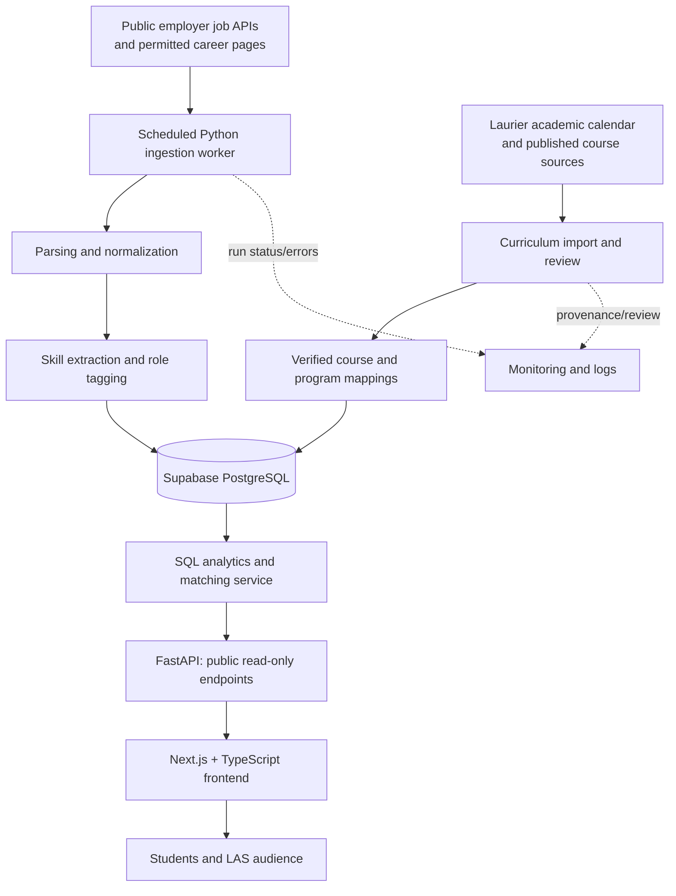
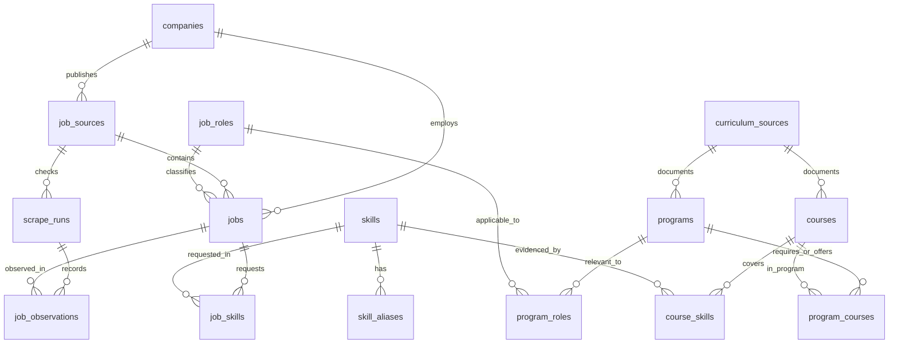

# LAS Curriculum-to-Career Intelligence Platform

> **Working title:** TBD  
> **Organization:** Laurier Analytics Society (LAS)  
> **Document:** `PROJECT.md` — product specification and technical source of truth  
> **Status:** Proposed architecture, not an implemented system  
> **Planning horizon:** Approximately 8 weeks; 5 contributors  
> **Last updated:** October 19, 2026

---

## 0. Read this first

This repository is intended to become a **Laurier-specific curriculum-to-career intelligence platform**. It will collect publicly accessible job postings, extract employer-required skills, map verifiable skills taught in Laurier courses, and show how those two datasets relate.

The product is **not simply another job board**. The distinguishing feature is an **explainable curriculum-to-job matching engine**. A student selecting a Laurier program should be able to see relevant roles, employers, overlapping skills, additional skills to explore, hiring trends, and direct links to the original postings.

This file defines the intended product, architectural boundaries, proposed database schema, pipeline contracts, UI expectations, API design, quality rules, and delivery plan. **It is a blueprint, not proof that any feature has been implemented.** Treat specifics marked *proposed*, *target*, or *optional* accordingly.

**Guiding principles**

1. **Evidence first.** Every displayed job comes from an identifiable source; every claimed course-skill connection links to supporting curriculum evidence.
2. **Explainability over black-box scores.** Show which skills match and why, alongside any alignment score.
3. **Honest labels.** “Covered in published coursework” is not the same as “student knows this skill.” “Skill overlap” is not “chance of getting hired.”
4. **Reliability before scale.** A smaller number of high-quality, consistently updated sources is more useful than thousands of stale or duplicate records.
5. **Modular, not overengineered.** Start with a modular Python ingestion service, PostgreSQL, a lightweight API, and one web app. Avoid unnecessary message queues, microservices, or model dependencies.
6. **Compliance by design.** Only access authorized public material and comply with source terms, robots directives where applicable, rate limits, and removal requests.

### Quick answers

| Question | Decision |
|---|---|
| Who is it for? | Laurier students exploring internships, co-ops, entry-level and new-graduate roles |
| What's different? | Program/course-to-job skill alignment grounded in published Laurier curricula |
| Where do jobs come from? | Public employer job board APIs first, permitted website scraping second |
| Where do course skills come from? | Official academic calendar, published course descriptions/outlines, with evidence and manual verification |
| Core backend? | Python; Scrapy/Playwright where needed; pandas for batch transforms; FastAPI |
| Database? | Supabase-hosted PostgreSQL, normalized and indexed |
| Frontend? | Next.js, TypeScript, React, Recharts; Cytoscape.js for an optional skill graph |
| Scheduled ingestion? | Cloud Scheduler → Cloud Run Job (or equivalent scheduled worker) |
| Initial authentication? | None required for public, read-only exploration |
| Timebox? | Eight weeks, with more ambitious features dependent on data quality and progress |

---

## 1. Problem and opportunity

Students often know their courses and degree requirements but cannot easily answer:

- Which Canadian employers are asking for skills covered by my Laurier program?
- Which internships or new-grad jobs overlap most closely with my coursework?
- What additional skills appear frequently in those roles?
- How are relevant roles distributed across locations, companies, industries, and work arrangements?
- When do employers publish opportunities, and how is demand changing in the *observed* dataset?
- How do the requirements of Data Analyst and Data Engineer, or Business Analyst and Software Engineer, compare?

Existing job boards organize postings around titles, keywords, and locations. This project adds a **university curriculum lens** by combining structured Laurier program/course information with real employer listings.

### Core value proposition

> **Connect what Laurier teaches to what employers request, with transparent evidence and current job-market data.**

### Target users and key workflows

| User | Main workflow | Outcome |
|---|---|---|
| Laurier student | Select program and academic calendar year → view career paths and matches | Understand where coursework aligns with job requirements |
| Student comparing career paths | Compare two role families | Discover shared/unique skill requirements and hiring patterns |
| Student building projects | Inspect frequently requested, not-yet-documented skills | Identify practical topics to learn or explore independently |
| LAS student/researcher | Explore skill trends and job-market breakdowns | Produce reproducible, source-backed insights |

### Product boundaries

**In scope:** Canadian opportunities with emphasis on Ontario; Laurier undergraduate programs; public job postings; program/course-skill evidence; program-aware matching; job search; salary/location trends when data exists.

**Out of scope for the first release:** automatically applying to jobs; scraping private Laurier systems or authenticated student portals; inferring an individual student's actual competencies from their degree; resume scoring; guaranteed internship eligibility; employer partnerships or hiring guarantees; scraping personal applicant information.

**Important distinction:** A company whose postings match Laurier curriculum is **not necessarily a company that directly recruits at Laurier**. The system must never imply a recruiting partnership or privileged access without evidence.

---

## 2. Proposed release scope

### P0 — must ship

1. **Reliable ingestion:** ingest jobs from multiple permitted public sources; schedule updates; deduplicate; preserve source identity, timestamps, and run health.
2. **Laurier curriculum dataset:** model a small number of real programs and their required courses, tied to a **specific academic calendar year** and official source URLs.
3. **Verified skill taxonomy:** normalize skill aliases across jobs and courses; allow manual review of curriculum assertions.
4. **Explainable matching:** calculate and display overlap between documented required-course skills and employer-requested skills, along with evidence, caveats, and unmatched requirements.
5. **Working web application:** program selector, program overview, jobs explorer, job detail with match explanation, role comparison, and essential analytics.
6. **Usable database/API:** migrations, constraints, indexes, pagination, filters, reproducible analytics queries, tests, deployment, and documentation.

### P1 — strong additions if P0 is healthy

- Role-specific skill co-occurrence network.
- Historical trends based on observed snapshots, clearly labeled by coverage window.
- Better role categorization and extraction accuracy through curated NLP/rule-based techniques.
- Salary normalization where compensation units and currency are unambiguous.
- Data quality/coverage dashboard for the team.

### P2 — stretch goals, not launch blockers

- Semantic search using embeddings and Supabase `pgvector`.
- User-selected completed/elective courses for **personalized coursework coverage** (without claiming skills were mastered).
- Opt-in accounts or saved roles.
- More advanced statistical detection of emerging skills after sufficient historical observations exist.
- Additional campuses, programs, and employer sources.

### Practical targets (adjust after initial source audit)

- A useful initial set of **3–5 accurately mapped Laurier programs**, rather than superficial coverage of every degree.
- Approximately **20–40 stable employer sources** if source availability and permissions allow; quality matters more than count.
- Regular ingestion and an honest data-freshness indicator.
- A complete end-to-end demo from a real course requirement through a verified skill to an active employer posting.

These are **targets, not promises**; usable data volume is determined by what external sources actually expose.

---

## 3. System architecture



### Runtime components

| Component | Proposed technology | Purpose |
|---|---|---|
| Job collectors | Python, HTTP client, Scrapy; Playwright only if needed | Fetch permitted job board listings, handle pagination and retries |
| Curriculum ingestion | Python + parsers; manual verification | Import official program/course facts and supporting skill evidence |
| Data processing | Python, pandas, spaCy/rule dictionaries | Validate/normalize source data; identify skill mentions and role types |
| Persistent store | Supabase PostgreSQL | Relational records, indexes, history, analytics queries |
| API | FastAPI + Pydantic | Stable filtered access to jobs, program data, matches, analytics |
| Frontend | Next.js, React, TypeScript, Recharts | User-facing program exploration and interactive dashboards |
| Optional graph visualization | Cytoscape.js | Skill co-occurrence network |
| Automation | Cloud Run Jobs + Cloud Scheduler | Periodic ingestion separate from user-facing requests |
| CI/CD | GitHub Actions | Lint, test, check migrations/builds, deploy where configured |
| Hosting | Vercel frontend; Cloud Run API; Supabase database | Simple managed deployment without microservices |

### Architecture decisions and why

- **Supabase is a database and associated managed platform, not the scraper runtime.** The Python worker runs separately and writes normalized records to PostgreSQL.
- **FastAPI mediates public reads.** The web client does not query privileged database tables with a service role key. Keep data access and matching logic in the backend.
- **Batch jobs are separate from HTTP requests.** A user loading a page must never trigger live scraping.
- **Rule-based skills first.** Skill aliases and contextual extraction produce explainable behavior. Add embedding models only if they solve a demonstrated problem.
- **Do not introduce Kafka, Redis, Kubernetes, or microservices by default.** Reevaluate when ingestion throughput, retry volume, or latency shows a specific need.

### Major data flows

**Job flow:** scheduled run → source fetch → source-specific adapter → canonical `RawJob` → validation and cleaning → role/skill extraction → database upsert → record successful observations → refresh analytics.

**Curriculum flow:** official source → program/course extraction → source link and academic year → evidence-backed course/skill suggestions → verification → stored program requirements and course-skill mappings.

**User request flow:** choose program → API resolves verified required-course skills → search relevant observed jobs → calculate job skill overlap → fetch evidence and aggregated insights → display match breakdown and links.

---

## 4. External data sources

### 4.1 Employer jobs: use source priority

1. **Public job board APIs** with documented GET endpoints and permitted terms. For example, Greenhouse Job Board API and Lever Postings API.
2. **Public employer career pages** where extraction is allowed, using Scrapy or a lightweight HTTP parser.
3. **JavaScript-rendered public pages** using Playwright only when necessary and permitted.
4. **Manual seed data** for local development or testing, clearly marked as synthetic; never mix it into real published market metrics.

Start with employer-hosted listings to preserve clear provenance and original application links. Greenhouse exposes publicly accessible job board GET methods; Lever publishes an API for public job postings. **The existence of a public endpoint does not override a site's usage terms, rate limits, or other access restrictions.**

**Example references:**
- Greenhouse Job Board API: <https://docs.greenhouse.io/job-board>
- Lever Postings API: <https://github.com/lever/postings-api>

### 4.2 Laurier curriculum sources

- **Primary source:** Wilfrid Laurier University's official undergraduate academic calendar, with program requirements for the student's **entry/admission year** where applicable.
- **Secondary evidence:** official course descriptions and published course outlines/syllabi when legally accessible and attributable.
- **Manual review:** course-skill claims that the public text does not clearly establish remain unverified and are excluded from default match calculations.

Official source references:
- Academic calendar guidance: <https://students.wlu.ca/academics/support-and-advising/calendars-and-petitions/academic-calendars/index.html>
- Academic calendar site: <https://academic-calendar.wlu.ca/>
- Example 2026/27 Computer Science department/course list: <https://academic-calendar.wlu.ca/department.php?cal=1&d=3249&s=1170&y=93>

**Do not assume a course is mandatory because it appears in the departmental course list.** Actual program requirements, concentrations, alternatives, catalog years, and electives must be modeled explicitly. Likewise, a course description is not conclusive evidence that students use a named tool or framework.

### 4.3 Source registry checklist

For each source, record: URL, organization, source type, public-access status, permitted collection method, review date, refresh frequency, rate limits, parser/adapter name, contact/removal route (if provided), source-specific identifiers, and known limitations.

No crawling authenticated resources, bypassing CAPTCHAs, evading IP bans, or ignoring explicit access restrictions. Respect robots directives where they apply, source terms, and conservative per-domain request budgets. If a source disallows collection, remove it from the ingestion configuration.

---

## 5. Data collection and processing contracts

### 5.1 Proposed normalized job input (`RawJob`)

All source adapters should return a consistent typed object before business logic touches it. Missing data is represented with `null`, not invented placeholders.

```json
{
  "source_key": "example_greenhouse_board",
  "external_id": "example-12345",
  "company_name": "Example Company",
  "title": "Data Analyst Intern",
  "source_url": "https://example.com/jobs/12345",
  "apply_url": "https://example.com/jobs/12345",
  "location_raw": "Toronto, ON, Canada",
  "description_text": "Example posting content",
  "posted_at": null,
  "employment_type_raw": "Internship",
  "work_mode_raw": "Hybrid",
  "salary_raw": null,
  "retrieved_at": "2026-10-19T20:00:00Z",
  "source_payload": {}
}
```

This is **mock structure**, not a real posting. Source adapters can additionally expose structured salary fields or metadata. Do not publish `source_payload` in the public API; assess whether storing full raw HTML/JSON is permitted and necessary.

### 5.2 Standard ingestion steps

1. **Discover source configuration** from enabled source records.
2. **Start `scrape_runs` entry**, including source ID, time, and adapter version.
3. **Fetch and paginate** with bounded concurrency, timeouts, exponential backoff, and clear rate limits.
4. **Parse** source-specific HTML/JSON into the normalized job contract.
5. **Validate** mandatory title, source URL, company and stable external source identity.
6. **Canonicalize** URLs, location fields, employment categories, timestamps, currencies, and text.
7. **Deduplicate** by `(source_id, stable_source_key)`; prefer provider job ID, fallback to a hash of a canonical source URL. Do not use the title alone as an identifier.
8. **Extract** role family, normalized skills, evidence snippets, and required/preferred/mentioned status.
9. **Upsert** in a transaction using PostgreSQL constraints; update changed fields and `last_seen_at`.
10. **Record observation and counts** only after valid ingestion; mark the run complete only after all expected pages were processed.
11. **Reconcile closures carefully.** A missing job can be marked inactive only after consecutive *fully successful* checks of the same source; never after an error or partial fetch.
12. **Log source health** and expose the latest successful refresh time for the dashboard.

### 5.3 Canonicalization rules

| Data | Rule |
|---|---|
| Job identity | Provider's published posting ID; fallback canonical URL hash scoped to source |
| Job title | Preserve raw display title; separately derive normalized `job_role_id` |
| Company | Normalize company name, but don't automatically merge unrelated companies with similar names |
| Locations | Keep original text plus parsed city/province/country; `remote`/`hybrid`/`onsite` is separate |
| Salary | Store raw text plus min/max/currency/period **only when unambiguous** |
| Dates | Store timezone-aware UTC timestamps; distinguish `posted_at`, `first_seen_at`, `last_seen_at` |
| Skills | Resolve aliases to canonical skills; retain evidence and confidence |
| Description | Strip executable markup; preserve meaningful text; sanitize anything rendered in UI |
| Duplicate sources | Preserve unique provider/source identity; cross-board deduplication is future work |

### 5.4 Salary handling

Never assume an absent salary means zero, or that hourly compensation is annual salary. Store `salary_period` (`hour`, `year`, etc.) and `currency` alongside ranges. For visualization, compare only compatible units or use explicitly labeled conversions with documented assumptions (e.g., assumed hours per week). Display the number and percentage of postings where salary is available.

### 5.5 Historical tracking rules

- `posted_at` comes from the employer when available; if absent, use `first_seen_at` for an **observed first-seen** metric only.
- An observation means **our collector saw that job on that run**, not that the job was first published then.
- A source's failed/partial run must not create false job closures or apparent hiring drops.
- Trend visualizations must disclose their observation window, source coverage, and collection methodology.
- A calendar month with no prior history must not be represented as zero market demand.

---

## 6. Skill extraction and curriculum mapping

### 6.1 Canonical taxonomy

The shared `skills` table is the bridge between employer jobs and Laurier courses.

Example canonical skills and aliases:

| Canonical skill | Possible aliases | Category |
|---|---|---|
| JavaScript | JS, ECMAScript | Programming language |
| PostgreSQL | Postgres, PostgreSQL DB | Database |
| Microsoft Excel | Excel, MS Excel | Analytics software |
| Power BI | Microsoft Power BI | BI / visualization |
| Python | Python 3 | Programming language |

Alias matching must consider word boundaries and context. For example, `R` and `Go` are ambiguous ordinary words and must not be extracted by naive substring matching.

### 6.2 Job-skill extraction

**Baseline algorithm**

1. Clean HTML and tokenize while preserving relevant technical identifiers (`C++`, `C#`, `.NET`, `Node.js`).
2. Apply curated skill names/aliases with boundary-aware matching (spaCy `PhraseMatcher` or equivalent).
3. Identify requirement context from nearby phrases (`required`, `must have`, `preferred`, `nice to have`).
4. Return `{skill_id, requirement_type, confidence, evidence_excerpt, extraction_version}`.
5. Combine duplicate mentions of the same skill; keep the strongest reliably supported requirement category.
6. Maintain a small labeled evaluation set from actual permitted job descriptions and measure precision/recall by skill category.

Avoid making an LLM mandatory to produce reliable basic extractions. A model-assisted extraction step can be experimented with later and must be evaluated against annotated data.

### 6.3 Laurier course-skill extraction

A separate, more conservative process applies to academic evidence:

1. Import an official program and its requirement structure for a known catalog year.
2. Import individual course codes, descriptions, links, and, where allowed, outlines.
3. Suggest potential skills based on explicit course outcomes, topic descriptions, or documented tools.
4. Record **evidence excerpt**, source URL, coverage type, and verification status.
5. Only `verified` course-skill mappings participate in the default alignment score.
6. Distinguish **required**, **choice-group**, **concentration**, and **elective** courses.

Coverage levels: `introduced` (mentioned/taught), `practiced` (applied in coursework), `assessed` (explicitly evaluated), and `mentioned` (insufficient confirmation). These levels should not claim individual proficiency.

**Critical:** By default, match against **verified skills from compulsory courses** only. An optional course must not be treated as something every student in that program takes. Later, if the student selects electives/completed courses, compute a separate personalized coursework alignment.

---

## 7. Proposed PostgreSQL data model

This is the planned **minimum production-oriented relational schema**, not a data dictionary inferred from existing records. Database migrations should implement and adjust it as source adapters are tested.

### 7.1 Entity relationship overview



### 7.2 Table inventory and field intentions

| Table | Main fields | Why it exists |
|---|---|---|
| `companies` | `id`, `name`, `slug`, `industry`, `careers_url` | One employer, many sources and postings |
| `job_sources` | `id`, `company_id`, `source_type`, `base_url`, `config`, `enabled`, `access_review_status` | Scraper configuration, provenance and compliance |
| `scrape_runs` | `id`, `source_id`, `status`, timestamps, counters, `error_summary` | Reliable monitoring, closure decisions, incident debugging |
| `job_roles` | `id`, `slug`, `name`, `category` | Normalized career role families |
| `jobs` | source key, company, title, description, URL, location, salary, role, employment type, status, first/last seen | Canonical current job state |
| `job_observations` | job, scrape run, observation time, content hash | Evidence a posting was present during a specific successful collection |
| `skills` | `id`, `slug`, `name`, `category` | Canonical vocabulary shared by both datasets |
| `skill_aliases` | `skill_id`, `alias`, `normalized_alias` | Reproducible skill-name resolution |
| `job_skills` | job, skill, requirement type, confidence, evidence, version | Employer requirement evidence |
| `curriculum_sources` | source URL/type, catalog year, access/review timestamps | Academic provenance |
| `programs` | program name, slug, catalog year, institution, source | Versioned Laurier degree/program model |
| `courses` | course code, title, catalog year, description, source | Versioned academic courses |
| `program_courses` | program, course, requirement type, choice group, suggested year | Degree requirements, not just a course list |
| `course_skills` | course, skill, coverage level, evidence, verification status | Traceable academic skill coverage |
| `program_roles` | program, role, relevance, rationale | Relevant role categories for user-facing discovery |

**Optional tables later:** `user_profiles`, `user_selected_courses`, `job_embeddings`, `feedback_reports`, and cached aggregate tables. These are **not** prerequisites for the initial release.

### 7.3 Proposed SQL schema (starting migration)

The following SQL is a coherent starting point for Supabase PostgreSQL. Run it through versioned migrations after review; it is **not yet a tested production migration**. Application logic still must handle data validity, source health and permissions.

```sql
-- Core identities
create extension if not exists pgcrypto;

create table companies (
    id uuid primary key default gen_random_uuid(),
    name text not null,
    slug text not null unique,
    industry text,
    careers_url text,
    created_at timestamptz not null default now()
);

create table job_sources (
    id uuid primary key default gen_random_uuid(),
    company_id uuid not null references companies(id),
    source_type text not null check (source_type in ('greenhouse', 'lever', 'html', 'custom_api')),
    base_url text not null,
    adapter_key text not null,
    config jsonb not null default '{}'::jsonb,
    enabled boolean not null default false,
    access_review_status text not null default 'pending'
        check (access_review_status in ('pending', 'approved', 'blocked')),
    last_success_at timestamptz,
    created_at timestamptz not null default now(),
    unique (company_id, base_url)
);

create table scrape_runs (
    id uuid primary key default gen_random_uuid(),
    source_id uuid not null references job_sources(id),
    started_at timestamptz not null default now(),
    finished_at timestamptz,
    status text not null default 'running'
        check (status in ('running', 'success', 'partial', 'failed')),
    fetched_count integer not null default 0 check (fetched_count >= 0),
    inserted_count integer not null default 0 check (inserted_count >= 0),
    updated_count integer not null default 0 check (updated_count >= 0),
    error_count integer not null default 0 check (error_count >= 0),
    error_summary text,
    adapter_version text
);

create table job_roles (
    id uuid primary key default gen_random_uuid(),
    slug text not null unique,
    name text not null,
    category text not null
);

create table jobs (
    id uuid primary key default gen_random_uuid(),
    source_id uuid not null references job_sources(id),
    company_id uuid not null references companies(id),
    source_key text not null,
    external_id text,
    title text not null,
    description_text text,
    source_url text not null,
    apply_url text,
    role_id uuid references job_roles(id),
    employment_type text not null default 'unknown'
        check (employment_type in ('internship', 'co_op', 'new_grad', 'full_time', 'part_time', 'unknown')),
    work_mode text not null default 'unknown'
        check (work_mode in ('onsite', 'hybrid', 'remote', 'unknown')),
    location_raw text,
    city text,
    province text,
    country text,
    salary_raw text,
    salary_min numeric(14,2),
    salary_max numeric(14,2),
    salary_currency char(3),
    salary_period text check (salary_period in ('hour', 'month', 'year', 'other')),
    posted_at timestamptz,
    first_seen_at timestamptz not null default now(),
    last_seen_at timestamptz not null default now(),
    status text not null default 'active'
        check (status in ('active', 'inactive', 'unknown')),
    missing_successful_runs integer not null default 0
        check (missing_successful_runs >= 0),
    content_hash text,
    updated_at timestamptz not null default now(),
    unique (source_id, source_key),
    check (salary_min is null or salary_min >= 0),
    check (salary_max is null or salary_max >= 0),
    check (salary_min is null or salary_max is null or salary_min <= salary_max)
);

create table job_observations (
    id bigint generated always as identity primary key,
    job_id uuid not null references jobs(id) on delete cascade,
    scrape_run_id uuid not null references scrape_runs(id) on delete cascade,
    observed_at timestamptz not null default now(),
    content_hash text,
    unique (job_id, scrape_run_id)
);

-- Skill taxonomy and job evidence
create table skills (
    id uuid primary key default gen_random_uuid(),
    slug text not null unique,
    name text not null,
    category text not null
);

create table skill_aliases (
    id uuid primary key default gen_random_uuid(),
    skill_id uuid not null references skills(id) on delete cascade,
    alias text not null,
    normalized_alias text not null unique
);

create table job_skills (
    job_id uuid not null references jobs(id) on delete cascade,
    skill_id uuid not null references skills(id) on delete cascade,
    requirement_type text not null default 'mentioned'
        check (requirement_type in ('required', 'preferred', 'mentioned')),
    confidence numeric(4,3) not null default 1.000
        check (confidence between 0 and 1),
    evidence_excerpt text,
    extraction_version text not null,
    extracted_at timestamptz not null default now(),
    primary key (job_id, skill_id)
);

-- Academic sources; store verified provenance
create table curriculum_sources (
    id uuid primary key default gen_random_uuid(),
    source_url text not null unique,
    source_type text not null
        check (source_type in ('academic_calendar', 'course_description', 'course_outline', 'other_official')),
    catalog_year text,
    title text,
    last_checked_at timestamptz,
    created_at timestamptz not null default now()
);

create table programs (
    id uuid primary key default gen_random_uuid(),
    institution text not null default 'Wilfrid Laurier University',
    name text not null,
    slug text not null,
    degree_type text,
    catalog_year text not null,
    source_id uuid references curriculum_sources(id),
    description text,
    unique (slug, catalog_year)
);

create table courses (
    id uuid primary key default gen_random_uuid(),
    code text not null,
    title text not null,
    catalog_year text not null,
    description text,
    source_id uuid references curriculum_sources(id),
    unique (code, catalog_year)
);

create table program_courses (
    program_id uuid not null references programs(id) on delete cascade,
    course_id uuid not null references courses(id) on delete cascade,
    requirement_type text not null
        check (requirement_type in ('required', 'choice_group', 'concentration', 'elective')),
    choice_group text,
    suggested_year smallint check (suggested_year between 1 and 6),
    notes text,
    primary key (program_id, course_id)
);

create table course_skills (
    course_id uuid not null references courses(id) on delete cascade,
    skill_id uuid not null references skills(id) on delete cascade,
    coverage_level text not null
        check (coverage_level in ('mentioned', 'introduced', 'practiced', 'assessed')),
    evidence_excerpt text not null,
    evidence_url text not null,
    verification_status text not null default 'pending'
        check (verification_status in ('pending', 'verified', 'rejected')),
    extraction_method text not null default 'manual'
        check (extraction_method in ('manual', 'rules', 'model_assisted')),
    verified_at timestamptz,
    primary key (course_id, skill_id)
);

create table program_roles (
    program_id uuid not null references programs(id) on delete cascade,
    role_id uuid not null references job_roles(id) on delete cascade,
    relevance text not null default 'related'
        check (relevance in ('primary', 'related', 'exploratory')),
    rationale text,
    primary key (program_id, role_id)
);

-- Frequently used filters, joins and diagnostics
create index jobs_active_role_idx on jobs (role_id, last_seen_at desc)
    where status = 'active';
create index jobs_company_idx on jobs (company_id);
create index jobs_location_idx on jobs (province, city);
create index jobs_employment_idx on jobs (employment_type, work_mode);
create index jobs_posted_idx on jobs (posted_at desc);
create index jobs_source_status_idx on jobs (source_id, status);
create index jobs_fts_idx on jobs using gin (
    to_tsvector('english', coalesce(title, '') || ' ' || coalesce(description_text, ''))
);
create index job_skills_by_skill_idx on job_skills (skill_id, requirement_type);
create index course_skills_by_skill_idx on course_skills (skill_id, verification_status);
create index program_courses_by_course_idx on program_courses (course_id);
create index scrape_runs_source_time_idx on scrape_runs (source_id, started_at desc);
create index job_observations_by_job_time_idx on job_observations (job_id, observed_at desc);
```

### 7.4 Schema rules and future refinements

- **Canonical identity:** `jobs.source_key` must be stable within a source; never re-key when a job title changes.
- **Company consistency:** the ingestion service must ensure `jobs.company_id` matches the referenced source's company; consider enforcing this later with a composite foreign key or database trigger.
- **Academic year consistency:** `program_courses` must connect course and program records for compatible catalog years. PostgreSQL checks cannot easily compare two other tables; enforce in a transaction/service validator or a database trigger.
- **Choice groups:** `choice_group` identifies alternatives, but a richer `requirement_groups`/`requirement_group_courses` schema may be needed for accurate “choose N from M” requirements. Do not count choice-group skills as guaranteed program coverage.
- **Program variants:** concentrations, double degrees, and streams may need distinct program rows or an explicit `program_tracks` table. Decide before claiming comprehensive curriculum coverage.
- **Extracted evidence:** retain only permissible content; cap excerpts. Different mentions or course documents may justify an evidence history table later.
- **Job identity across sources:** the initial unique key prevents duplicates *within* one source, not cross-posts by the same company on different ATS sites; detect and flag, do not blindly merge.
- **Historical accuracy:** `job_observations` records observed presence, not historical copies of every attribute. If trend reporting needs changes in salaries or descriptions over time, add a `job_revisions` table with before/after values or versioned snapshots.
- **Deletion:** establish retention and removal behavior for stale postings and raw content; preserve only aggregated/non-prohibited historical counts where appropriate.
- **Migration process:** run SQL with Supabase CLI migrations; never edit the production schema only through ad-hoc dashboard clicks.
- **Security:** use a private schema and narrowly privileged database credentials for ingestion where practical. If any tables are in an exposed Supabase schema, enable RLS and restrict grants even if FastAPI normally mediates reads.

### 7.5 Useful derived views/queries

These are **analytics definitions**, not an assertion that there are already meaningful results.

**Top skills for active internships**

```sql
select s.name,
       count(distinct js.job_id) as posting_count
from job_skills js
join skills s on s.id = js.skill_id
join jobs j on j.id = js.job_id
where j.status = 'active'
  and j.employment_type in ('internship', 'co_op')
group by s.id, s.name
order by posting_count desc, s.name
limit 20;
```

**Verified skills from compulsory courses in one program**

```sql
select distinct s.id, s.name, s.category
from program_courses pc
join course_skills cs on cs.course_id = pc.course_id
join skills s on s.id = cs.skill_id
where pc.program_id = :program_id
  and pc.requirement_type = 'required'
  and cs.verification_status = 'verified'
  and cs.coverage_level in ('introduced', 'practiced', 'assessed')
order by s.name;
```

` :program_id ` above is a named parameter placeholder to bind in application code, **not directly runnable PostgreSQL SQL** without substitution. Include reporting denominators (e.g., all observed active relevant postings) alongside counts. For “top skills this month,” filter by a clearly defined observation window and restrict to sources with valid collection coverage.

### 7.6 Indexing and query optimization strategy

1. Make ingestion **idempotent** with PostgreSQL `INSERT ... ON CONFLICT (source_id, source_key) DO UPDATE`.
2. Put indexes on frequently used filters **and foreign-key join directions**; verify with `EXPLAIN (ANALYZE, BUFFERS)` against realistic data.
3. Use cursor or stable offset pagination for public job browsing; bound page sizes.
4. Store canonical skill IDs to avoid repeated text joins during every request.
5. Cache/aggregate costly trends only after profiling. PostgreSQL materialized views may help but need explicit refresh timing and freshness labels.
6. Avoid collecting daily full text copies if content hashes + observations meet the initial analytic requirements.
7. Establish simple retention/archival settings for scraped records, logs, and observations.

---

## 8. Curriculum-to-job matching engine

### 8.1 Terminology

- **Curriculum skill:** a skill **explicitly documented** in official Laurier course evidence and verified for inclusion.
- **Job skill:** a normalized skill extracted from the employer's published requirements.
- **Skill alignment:** overlap between those two evidence sets, **not** the probability of being hired.
- **Unmapped requirement:** requested in a job but not in the verified curriculum set. Do not automatically call it a “missing student skill.”

### 8.2 Proposed baseline scoring algorithm

For job `J` and program `P`:

1. Determine `P`'s verified skills from **required courses** for the selected catalog year.
2. Determine `J`'s required/preferred/mentioned skill set, using extraction confidence.
3. Give job requirements relative weights: `required = 3`, `preferred = 1.5`, `mentioned = 1` (**initial heuristic; calibrate**).
4. For each skill, map the strongest verified required-course coverage to a coverage weight: `introduced = 0.35`, `practiced = 0.70`, `assessed = 1.0`. These are **design weights**, not measured mastery levels.
5. Compute an overlap percentage:

   ```text
   weighted_job_skill = requirement_weight * extraction_confidence
   alignment_percent = 100 * sum(weighted_job_skill * curriculum_coverage)
                           / sum(weighted_job_skill)
   ```

6. If a job has **no confidently extracted skills**, report **“insufficient evidence”**, not a 0% score.
7. Display the matched skill names, their course evidence, uncovered job requirements, scoring method, and source freshness beside the number.

**Default interpretation:** A score of 75% means the *documented required-course curriculum evidence* overlaps with approximately 75% of the weighted extracted job skill requirements under this model. It **does not mean** the student knows 75% of the job, is 75% qualified, or has a 75% probability of an interview.

### 8.3 Matching and ranking safeguards

- Rank within **relevant role families**, not simply all jobs with one common skill.
- Differentiate actual `required` from `preferred` evidence. A skill named casually in a posting is not automatically required.
- Display eligibility constraints (work authorization, degree, graduation date, year of study) only when explicitly provided and extracted reliably. Do not silently claim a student is eligible.
- Offer explanation links: `job requirement → extracted evidence → canonical skill → required Laurier course → academic source`.
- Do not count students' unspecified electives or concentrations as taken.
- A richer profile can later allow students to select completed courses; that result must have a different label from program-wide alignment.

### 8.4 Example (illustrative, not real data)

**Program:** Laurier Computer Science, selected catalog year  
**Posting:** Example Backend Developer Internship

| Skill from posting | Requirement | Evidence in verified required courses? | UI interpretation |
|---|---|---|---|
| Java | Required | Yes, if supported by official course evidence | Documented overlap |
| SQL | Required | Yes, if supported by official course evidence | Documented overlap |
| Docker | Preferred | No verified mapping | Additional skill to explore |
| AWS | Mentioned | No verified mapping | Additional skill to explore |

The actual program mapping must be derived from the calendar and course evidence. This table is for product behavior only.

### 8.5 Validating the score

Before exposing a percentage prominently, evaluate a manually reviewed set of program-job pairs for whether the ordering and explanations make sense. Track false-positive/false-negative skill extraction, source completeness, role classification errors, and whether the score overvalues generic skills. Allow the numerical score to be hidden or labeled experimental until it performs credibly.

---

## 9. User-facing application

### 9.1 Primary navigation and pages

**A. Landing / onboarding**
- What the platform does, methodology, collection limitations, and latest refresh.
- Select Laurier program, catalog year, and optionally internship/new-grad interest.
- Start exploring without an account.

**B. Program dashboard (`/programs/[slug]`)**
- Program name, academic calendar year and source link.
- Count of verified required-course skills; top matching role categories.
- Job counts by category/location, clearly tied to dataset coverage.
- Frequently requested skills from relevant jobs, including curriculum overlap.
- Link to course evidence and limitations.

**C. Job explorer (`/jobs`)**
- Search, filter by program, role, employer, work mode, employment type, city/province, salary availability and freshness.
- Server-side pagination and stable sort by relevance/date.
- Each result includes company, title, location, source, last seen, optional alignment score and link to original application.

**D. Job detail (`/jobs/[id]`)**
- Employer/source, title, posting text or permitted summary, location, job type, salary where available.
- Matched skills vs. requirements without verified curricular evidence.
- The exact Laurier course(s) behind documented matches.
- Original posting/apply link and freshness disclaimer.

**E. Role comparison (`/compare`)**
- Compare two role families on skill demand, location distribution, salary coverage/ranges, observed opportunity counts and common requirements.
- Keep denominators and time range visible.

**F. Trends (`/trends`)**
- Top skills, posting volume, location distribution, role trends, seasonal observations.
- Source coverage, collection date range and failure caveats adjacent to charts.

**G. Optional skill network (`/skills`)**
- Co-occurrence connections from job skills, configurable role/time filters.
- Edges represent jobs mentioning both skills, not curriculum prerequisites.

### 9.2 UX requirements

- Responsive desktop and mobile design; charts work with keyboard navigation and have readable table alternatives.
- Loading, empty, missing-data and API-failure states are designed intentionally.
- No fabricated salary values, dates or scores to fill blank cards.
- Every analytical chart says **what data and time window it represents**.
- Clearly distinguish verified course coverage from algorithmically extracted job content.
- External application buttons always open original employer job pages.

---

## 10. API design (proposed v1)

Namespace: `/api/v1`. All endpoints are **read-only** for the public application. Admin ingestion/review operations stay on a private tool path, not the public API.

| Endpoint | Purpose | Common parameters |
|---|---|---|
| `GET /health` | API health (no secrets) | None |
| `GET /api/v1/metadata` | Supported filters, data freshness, coverage | None |
| `GET /api/v1/programs` | Catalog-aware Laurier program list | `catalog_year`, `search` |
| `GET /api/v1/programs/{id}` | Program, curriculum breakdown and official sources | None |
| `GET /api/v1/programs/{id}/skills` | Verified coursework skills and evidence | `required_only` |
| `GET /api/v1/programs/{id}/matches` | Program-ranked job matches and explanations | `role`, `location`, `employment_type`, `page_size`, `cursor` |
| `GET /api/v1/jobs` | Searchable observed job postings | `q`, `role`, `province`, `work_mode`, `employment_type`, `page_size`, `cursor` |
| `GET /api/v1/jobs/{id}` | Job detail and source provenance | None |
| `GET /api/v1/jobs/{id}/alignment` | Alignment against specific program | `program_id` |
| `GET /api/v1/roles` | Role categories and posting counts | `program_id` |
| `GET /api/v1/analytics/skills` | In-demand skill frequency | `role`, `date_from`, `date_to`, `province` |
| `GET /api/v1/analytics/trends` | Observed volume/time series | `role`, `date_from`, `date_to`, `group_by` |
| `GET /api/v1/analytics/compare` | Two-role comparison | `role_a`, `role_b`, `date_from`, `date_to` |

**Sample shape: `GET /api/v1/jobs/{id}/alignment?program_id=...`**

```json
{
  "job_id": "example-job-uuid",
  "program_id": "example-program-uuid",
  "status": "scored",
  "alignment_percent": 71.4,
  "score_version": "heuristic-v1",
  "matched_skills": [
    {
      "skill": "SQL",
      "requirement_type": "required",
      "coverage_level": "practiced",
      "supporting_courses": [
        {
          "code": "EXAMPLE101",
          "evidence_url": "https://example.edu/course"
        }
      ]
    }
  ],
  "unmapped_job_skills": ["Docker"],
  "disclaimer": "Curriculum alignment is not evidence of individual proficiency or hiring eligibility."
}
```

This is a **shape example with synthetic IDs/course data**, not a genuine match. Return `alignment_percent: null` and `status: "insufficient_evidence"` when scoring is inappropriate.

### API implementation conventions

- OpenAPI schema generated by FastAPI; Pydantic input/output models.
- Validate enums, dates, UUIDs, page size, and allowed sort fields.
- Query parameter names and response versions remain stable within `/v1`.
- Pagination defaults to a small page size with a sensible maximum.
- Use consistent errors (`code`, `message`, `request_id`); don't leak SQL, credentials, or scraper traces.
- Rate-limit public endpoints if needed; avoid exposing full raw source payloads.
- Prefer filtering/aggregation in SQL over loading all rows into Python on every request.

---

## 11. Analytics definitions and methodology

| Metric | Definition | Caveat |
|---|---|---|
| Active observed jobs | Unique postings most recently considered active after a successful source refresh | Not every job in Canada; source coverage matters |
| Most requested skill | Share of relevant observed postings that mention canonical skill | Skill extraction has false positives/negatives |
| Role demand | Observed distinct job postings by normalized role | Depends on employer mix and role classifier |
| Salary distribution | Distribution of postings with compatible, explicitly reported pay | Not representative if many postings omit compensation |
| Employer ranking | Distinct observed postings by company | Not a direct measure of hiring headcount |
| Trend | Change in observed source-consistent counts/share by time period | New sources or failed runs can distort comparisons |
| Curriculum alignment | Weighted overlap of verified required-course skills and extracted job skills | Not individual readiness or job success likelihood |

### Correct time-series treatment

- Prefer a **fixed source cohort** for period-over-period comparisons; identify newly added or failed sources.
- Define whether a point reflects `first_seen`, `observed_active`, or employer `posted_at`; these are different measures.
- Normalize skill trends by the number of relevant postings (e.g., percentage mentioning SQL), not only raw counts.
- Do not describe eight weeks of observations as a long-term labour-market trend.
- Display coverage and extraction uncertainty; include an explanation page with formulas and known limitations.

### Data quality indicators

Track ingestion run success rate, fraction of active sources with recent successful refreshes, duplicate rate, missing-description fraction, salary coverage, role-classification completeness, skill-extraction precision/recall on labeled data, and verified curriculum evidence coverage. A data-quality panel is desirable even if it starts as a private internal report.

---

## 12. Security, privacy, compliance and operations

### Security

- Never commit secrets, tokens, passwords, private credentials, or environment files.
- Supabase service-role/secret keys are **server-only**; never include them in `NEXT_PUBLIC_*` variables.
- Prefer least-privilege database roles for the worker and API; separate write access from read access.
- Restrict Supabase exposed schema grants and enable Row Level Security where applicable. Evaluate the security implications of views/functions too.
- Sanitize scraped content before HTML rendering to prevent XSS; prefer plain text and safe links.
- Validate redirect URLs before using them as external job application targets.
- Set bounded timeouts, retries, maximum response sizes, and resource budgets for scrapers.
- Public endpoints require request validation and rate controls if abused.

### Privacy

- No student login required for MVP; default program selection can remain client-side.
- Do not collect applicant personal data or resumes from external websites.
- Analytics should operate on job postings and publicly published academic information, not inferred student-specific records.
- Any future accounts/saved preferences require a separate privacy design and deletion mechanism.

### Content/source compliance

- Follow source terms, robots directives where applicable, crawl budgets, and copyright/use restrictions.
- Use APIs where allowed; no bypassing logins or access controls.
- Where permissions are unclear, exclude the source until reviewed.
- Store only source content necessary and allowed for analysis; summarize or link rather than republishing entire listings if restrictions apply.
- Maintain original URLs and honor reasonable takedown/removal requests.
- Do not describe the project as official Laurier software or a Laurier Career Centre integration without approval; LAS branding and institutional affiliation should be accurate.

### Monitoring and incident response

- For each source: last success, duration, fetched/inserted/updated counts, parsing errors, repeated failure alerts.
- Alert when an adapter returns suspiciously zero jobs, suddenly drops in count, or fails repeatedly.
- Avoid destructive closure reconciliation after partial runs.
- Document the ability to disable one problematic source without pausing all ingestion.
- Use structured logs and error categories, without recording secrets or sensitive data.
- Plan a rollback path for schema migrations and deployment failures; use managed database backups appropriate to the plan.

---

## 13. Repository layout and conventions

```text
repository-root/
├── PROJECT.md                     # This file: what/why/how
├── README.md                      # Setup, quickstart, status and links
├── apps/
│   └── web/                       # Next.js + TypeScript
│       ├── app/                    # Routes and pages
│       ├── components/             # Reusable UI and charts
│       ├── lib/                    # Typed API clients and helpers
│       └── tests/
├── services/
│   ├── api/                       # FastAPI/Pydantic application
│   │   ├── app/
│   │   │   ├── routes/
│   │   │   ├── schemas/
│   │   │   ├── queries/
│   │   │   └── services/          # Matching/analytics orchestration
│   │   └── tests/
│   └── ingestion/                 # Python collection and transforms
│       ├── adapters/              # Greenhouse, Lever, HTML adapters
│       ├── contracts/             # RawJob and normalization models
│       ├── processing/            # Cleanup and normalization
│       ├── extraction/            # Skill taxonomy and NLP
│       ├── curriculum/            # Academic import/verification workflows
│       └── tests/
├── database/
│   ├── migrations/                # Versioned Supabase SQL
│   ├── seed/                      # Synthetic demo data and taxonomy
│   └── queries/                   # Reusable analytics SQL
├── docs/
│   ├── SOURCES.md                 # Approved sources, access constraints
│   ├── DATA_DICTIONARY.md         # Exact schema/field semantics
│   ├── MATCHING.md                # Formula, evaluation and limitations
│   ├── RUNBOOK.md                 # Operations, incident recovery
│   └── DECISIONS.md               # Architecture decision log
├── .github/
│   └── workflows/                 # Lint, tests, build, deployments
├── .env.example                   # Names only, never real values
└── LICENSE                       # If open-sourcing is approved
```

### Local development (target)

1. Clone repo; install Node.js and Python versions specified in `README.md`.
2. Copy `.env.example` to local environment files and configure **development** Supabase credentials.
3. Apply migrations to a local or separate development database.
4. Seed a tiny synthetic dataset: 2 employers, 4 jobs, 1 program, 3 courses, 5 skills.
5. Start FastAPI and Next.js independently.
6. Run one controlled ingestion adapter against an approved public source or a fixture.
7. Run tests, lints, and schema checks before opening a pull request.

### Suggested environment variables

```dotenv
# Backend / worker only; values supplied locally or by deployment secret manager
DATABASE_URL=
SUPABASE_URL=
SUPABASE_SERVICE_ROLE_KEY=
LOG_LEVEL=INFO
SCRAPER_USER_AGENT=
MAX_CONCURRENT_REQUESTS=3

# Frontend
NEXT_PUBLIC_API_BASE_URL=http://localhost:8000
```

Only include service-role credentials when required by the chosen server architecture; a narrowly scoped PostgreSQL role is preferable where feasible. The frontend requires only the public API base URL in the initial design.

### Engineering practices

- Keep source adapters isolated behind one normalized contract.
- Add fixtures for common employer API payloads and unexpected/missing fields.
- Use typed Python models and TypeScript API interfaces; avoid untyped `any` data at network boundaries.
- Keep SQL migrations versioned and reviewable.
- Require CI checks and basic code review for merges to the default branch.
- Use predictable naming, idempotent commands, and clear logging.
- Document meaningful architectural changes in `docs/DECISIONS.md`.

---

## 14. Testing and acceptance criteria

### Core automated tests

| Test level | What to verify |
|---|---|
| Adapter unit tests | Greenhouse/Lever/HTML parsing, pagination, missing/null fields, malformed payloads |
| Normalization tests | URL canonicalization, salary units, timestamp handling, locations, job identity |
| Skill extraction tests | Aliases, boundaries, ambiguity (`R`, `Go`), required/preferred contexts |
| Database tests | Unique/upsert behavior, foreign keys, migration repeatability, indexing assumptions |
| Reconciliation tests | Failed/partial runs **never** close jobs; confirmed successful absence follows configured threshold |
| Curriculum tests | Catalog year isolation, mandatory vs elective/choice-group logic, evidence verification |
| Matching tests | Deterministic weights, explainable outputs, empty-data behavior, no electives by default |
| API integration tests | Search filters, pagination, schema validation, correct errors |
| Frontend tests | Critical navigation, filtering, match explanation, empty states, responsive views |
| End-to-end test | Official academic source → verified course skill → job requirement → visible matching explanation |

### Definition of done for v1

- [ ] At least several approved employer sources run on schedule, with visible refresh/error status.
- [ ] Repeated ingestion does not create source-level duplicates.
- [ ] Partial/failed runs do not cause false job closures.
- [ ] A small set of Laurier programs is mapped to official catalog-year requirements.
- [ ] Every default program-skill assertion used in matching has an evidence link and verified status.
- [ ] An actual employer job can be linked to canonical skills and a defensible, explained program match.
- [ ] Searching, filtering, program selection and job-detail exploration work end-to-end.
- [ ] Trends/salary cards include correct denominators, source scope and missing-data caveats.
- [ ] No secrets exposed to browser or repository; DB access restricted appropriately.
- [ ] Core tests run in CI; frontend/API/worker deploy cleanly.
- [ ] `README.md`, setup instructions, source registry, data dictionary and runbook are usable by a new contributor.

---

## 15. Eight-week implementation plan

This is a **sequence of project milestones**, deliberately not an assignment of tasks to specific people.

| Period | Deliverables | Exit condition |
|---|---|---|
| **Week 1** | Source access audit; final scope; initial schema; repository tooling; rough UI wireframes; program shortlist | Agreed source list and migrations; at least one official curriculum source mapped |
| **Week 2** | Greenhouse/Lever adapters; job normalization; ingestion into dev database; course/program import | End-to-end job records and academic records are visible in development |
| **Week 3** | Skill taxonomy and aliases; extraction prototype; verified course evidence workflow; scrape-run monitoring | Job skills and verified curriculum skills share consistent IDs |
| **Week 4** | Matching heuristic and tests; first public API endpoints; program/job browse UI | One real source-backed program-to-job match displayed and explained |
| **Week 5** | Job explorer filters; program dashboard; role comparisons; source freshness | The complete primary user workflow works without manual DB queries |
| **Week 6** | Trends and salary analytics; stability, indexing, data-quality review | Metrics reproduce from SQL and cite source/date coverage |
| **Week 7** | E2E testing; accessibility; source failure handling; CI/deployment; optional advanced graph | Deployment candidate with no blocking data integrity/security issues |
| **Week 8** | Bug fixing, evaluation, performance tuning, docs, production deployment and demonstration | Meets v1 checklist and can be maintained by incoming LAS contributors |

**Scope trade-offs:** If scraping coverage proves unreliable, reduce source count rather than weaken data provenance. If course skills are not verified, ship fewer programs rather than pretend elective/uncertain mappings are compulsory. If matching lacks evidence, show a descriptive skill breakdown and postpone the percentage.

---

## 16. Known risks and mitigations

| Risk | Why it matters | Mitigation |
|---|---|---|
| Source permission changes | Legal/technical access may end | Access register, allowlists, disable switches, API-first strategy |
| Scraper breakage | Empty/incorrect datasets or fake trend drops | Contract fixtures, parser health metrics, anomaly warnings |
| Weak curriculum evidence | Inaccurate academic skill claims | Manual verification, official links, program-year versioning |
| Elective overcounting | Inflates alignment | Required-only baseline; choice-group logic explicit |
| False-positive NLP | Inflates skill frequencies and matches | Alias tests, context rules, labeled evaluation set |
| Low salary coverage | Misleading pay comparisons | Report coverage denominator, raw units and compatible subsets |
| Limited history | Trends not yet meaningful | Label first-seen vs posted date; report observation period |
| Duplicate posts | Distorts company/skill rankings | Unique keys per source, optional cross-source review |
| Overambitious scope | P0 product unfinished | Strict P0/P1/P2 ordering and weekly milestone gates |
| Public data changes | Source job closes or updates | Last seen, confirmation threshold, freshness labels |
| Security misconfiguration | Privileged database access leaks | Backend-only secrets, grants/RLS review, CI secret scanning |

---

## 17. Open decisions that must be recorded before implementation

These are implementation decisions, **not reasons to delay initial scaffolding**:

1. **Product name and branding:** working title remains TBD.
2. **Initial program set:** choose three to five with reliable official curriculum evidence.
3. **Catalog-year behavior:** require explicit year selection or default to the current calendar with a prominent reminder that requirements differ by entry year.
4. **Source allowlist:** which employers and ATS sources are accessible and approved for collection?
5. **Exact salary policy:** display raw ranges only initially, or normalize selected compatible units?
6. **Skill taxonomy review process:** how are ambiguous aliases and disputed course evidence corrected?
7. **Matching calibration:** when is a numerical score appropriate versus qualitative explanations?
8. **Hosting budget and refresh frequency:** choose a budget that supports allowed source rates and analytics needs.
9. **Licensing and public release:** ensure the team has permission to open source code and distribute any curated dataset.

Maintain decisions in `docs/DECISIONS.md` with context, options considered, selected approach, and date.

---

## 18. Future evolution

After the first eight-week release proves data quality and usefulness, possible enhancements include:

- Student-selected completed courses and electives for a separate personalized curriculum view.
- Semantic search with embeddings using PostgreSQL `pgvector`, only when text search misses clear use cases.
- Additional Laurier programs and concentrations; cross-campus filters.
- A graph model connecting programs → courses → skills → jobs → companies.
- More robust skill demand detection using larger historical cohorts and source-adjusted trends.
- Instructor/Career Centre collaboration **only with explicit permission**, potentially improving the mapping evidence.
- Saved comparisons, exports, accessibility improvements and mobile-focused experience.

Do not confuse a future idea with a current dependency: **the initial value is the reliable evidence-backed bridge between a Laurier curriculum and real job requirements.**

---

## 19. Reference documentation

These are intended as implementation/reference links, not proof of unrestricted permission to scrape or redistribute data. Confirm terms and versions again when implementing.

### Laurier

- [Laurier academic calendar guidance](https://students.wlu.ca/academics/support-and-advising/calendars-and-petitions/academic-calendars/index.html)
- [Wilfrid Laurier University undergraduate academic calendar](https://academic-calendar.wlu.ca/)
- [Example: 2026/27 Computer Science offerings](https://academic-calendar.wlu.ca/department.php?cal=1&d=3249&s=1170&y=93)

### Job board APIs

- [Greenhouse Job Board API](https://docs.greenhouse.io/job-board)
- [Lever Postings API](https://github.com/lever/postings-api)

### Platform and database

- [Supabase Database documentation](https://supabase.com/docs/guides/database/overview)
- [Supabase Row Level Security](https://supabase.com/docs/guides/database/postgres/row-level-security)
- [Supabase `pgvector` extension](https://supabase.com/docs/guides/database/extensions/pgvector)
- [PostgreSQL documentation](https://www.postgresql.org/docs/)

### Implementation libraries

- [FastAPI](https://fastapi.tiangolo.com/)
- [Scrapy](https://docs.scrapy.org/)
- [Playwright Python](https://playwright.dev/python/)
- [pandas](https://pandas.pydata.org/docs/)
- [spaCy](https://spacy.io/usage)
- [Next.js](https://nextjs.org/docs)
- [Recharts](https://recharts.org/)

---

## 20. One-sentence project summary

**Build an explainable job-market intelligence platform that connects verified Wilfrid Laurier University curriculum skills with real employer requirements, supported by compliant automated collection, structured PostgreSQL data, transparent matching, and a useful web dashboard.**
